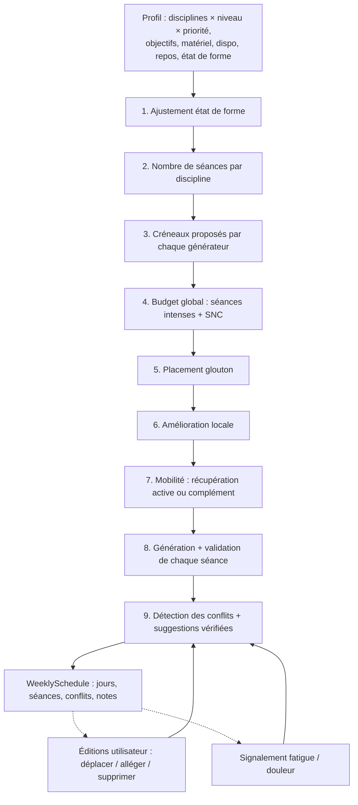

# Architecture logique de l'orchestrateur hebdomadaire

L'orchestrateur construit la semaine d'entraînement d'un utilisateur à partir de plusieurs disciplines. Il répartit les séances selon les priorités, les disponibilités et la charge globale : volume, séances intenses, stress nerveux (SNC) et interférences entre séances. Il ne génère aucun contenu lui-même : chaque discipline garde son générateur et ses propres règles métier.

Code : [`src/planner/`](../src/planner/). Point d'entrée : `planWeek(profil, { weekIndex })`.

## Vue d'ensemble



## Répartition des responsabilités

| Composant | Décide | Ne décide pas |
|---|---|---|
| **Générateur de discipline** (`generators/*`) | Les types de séance de la semaine pour sa discipline (`planSlots`) : répartition haut/bas, une seule séance de qualité en course, rotation des formats HIIT… Puis le contenu de chaque séance (`generate`). Il déclare la charge de chaque créneau sur 5 axes, notés de 0 à 3 : bas du corps, haut du corps, cardio, impact, SNC. | Le jour, ni ce que font les autres disciplines |
| **Orchestrateur** (`planner/orchestrator.ts`) | Le nombre de séances par discipline, le passage en variantes modérées, le placement dans la semaine, la mobilité | Le contenu des séances |
| **Règles d'interférence** (`planner/interference.ts`) | Ce qui est incompatible entre deux séances, et dans quel délai | — |
| **Détection** (`planner/conflicts.ts`) | Les conflits d'une semaine (paires de séances et contraintes globales), avec des suggestions vérifiées par simulation | — |

Les **mêmes règles** servent au placement (comme coût) et à la détection (comme conflit). L'orchestrateur évite donc d'emblée ce que la détection signalerait, et un déplacement fait par l'utilisateur est jugé selon les mêmes critères.

## Étapes

### 1. Ajustement selon l'état de forme
| État déclaré | Intensité max | Volume | Effet |
|---|---|---|---|
| normal | high | ×1 | — |
| fatigue `elevated` | moderate | ×0,8 | La séance de qualité en course devient un footing |
| fatigue `high` | low | ×0,6 | Aucune séance intense |
| blessure | low | ×0,6 | Mobilité douce uniquement, avec une note qui renvoie vers un professionnel de santé |

### 2. Nombre de séances
- Par défaut : 3 séances pour la priorité 1, 2 pour la priorité 2, 1 pour la priorité 3. L'utilisateur peut fixer lui-même le nombre (`sessionsPerWeek`).
- Le total est plafonné par : le nombre de jours disponibles (hors jours de repos préférés), un maximum de 6, et le niveau le plus élevé déclaré (débutant 4, intermédiaire 5, avancé 6).
- On réduit d'abord les disciplines les moins prioritaires. Chaque réduction est expliquée dans `notes`.
- Les disciplines en `tracking_only` ou en `alpha` ne sont pas générées, et une note l'indique. Une discipline en `beta` est générée avec un avertissement.

### 3. Créneaux proposés par les générateurs
Chaque générateur renvoie des `SlotSpec` : la variante, l'intensité, la charge sur 5 axes, la durée minimale et la durée souhaitée, et si la séance peut s'ajouter à une autre le même jour. Exemples :

| Séance | Intensité | Bas du corps | Cardio | Impact | SNC |
|---|---|---|---|---|---|
| Muscu force max, bas du corps | high | 3 | 1 | 0 | 3 |
| Muscu hypertrophie, haut du corps | high | 0 | 1 | 0 | 1 |
| Course : fractionné VMA | high | 2 | 3 | 3 | 2 |
| Course : footing | low | 1 | 2 | 2 | 0 |
| HIIT (intermédiaire) | high | 2 | 3 | 2 | 2 |
| Mobilité | low | 0 | 0 | 0 | 0 |

Si une séance est plafonnée en intensité, son SNC baisse d'un point par cran retiré (`cnsAfterCap`).

### 4. Budget global
Tant que la semaine dépasse le **nombre maximal de séances intenses** (débutant 2, intermédiaire 3, avancé 4) ou le **budget SNC** (somme des scores : 5, 8 ou 11 selon le niveau), on redemande des créneaux plafonnés à `moderate` au générateur de la discipline la moins prioritaire.

C'est le générateur qui applique ses propres règles : un fractionné devient un footing, pas un « fractionné doux ».

### 5. Placement glouton
Les créneaux sont triés par priorité, puis intensité, puis durée. Chacun va au jour qui minimise ce coût :

```
coût(jour, créneau) =
    ∞  si le jour est indisponible, s'il a déjà une séance principale, ou s'il est trop court
  + Σ pénalité(règle) pour chaque interférence avec une séance déjà placée
  + 3 / distance(jours)  pour chaque séance de la même discipline (étalement)
  + (durée souhaitée − durée disponible) / 10  si le jour est plus court que souhaité
  + 0,01 × index du jour  (départage stable)
```

### 6. Amélioration locale
Le placement glouton se bloque parfois : la discipline n°1, placée en premier, ignore les suivantes. Exemple : 3 courses placées, puis 2 séances de muscu qui finissent coincées contre elles.

On teste alors chaque **déplacement vers un jour libre** et chaque **échange** entre deux séances. Tout changement qui réduit le coût total de la semaine est conservé, jusqu'à ce qu'aucun ne l'améliore plus (10 passes au maximum, 7 jours).

### 7. Mobilité
La mobilité est placée en priorité sur un jour disponible sans séance (récupération active). Sinon, elle s'ajoute à une autre séance du jour (15 min) s'il reste au moins 10 min. Elle est au statut `active_recovery` et ne déclenche aucune interférence.

### 8. Génération et validation
Chaque séance est générée pour le **temps réellement disponible** ce jour-là, puis validée :
- le format de bloc est autorisé pour la discipline ;
- l'exercice appartient à la discipline ;
- la mesure demandée est compatible avec l'exercice (charge, distance) ;
- l'exercice est faisable avec le matériel, le lieu et les contraintes de l'utilisateur.

Une séance invalide remonte sous forme de conflit `infeasible`.

### 9. Détection des conflits

**Règles d'interférence** (entre deux séances, dans un ordre donné) :

| Règle | Avant → après | Délai minimal | Gravité | Pénalité |
|---|---|---|---|---|
| `heavy_legs_then_vma` | Lourd jambes → fractionné / VMA | 48 h* | **error** | 30 |
| `vma_then_heavy_legs` | Fractionné → lourd jambes | 48 h* | warning | 10 |
| `high_then_high` | Intense → intense | 48 h* | warning | 10 |
| `lower_body_overlap` | Bas du corps sollicité ≥ 2, deux fois | 48 h* | warning | 6 |
| `upper_body_overlap` | Haut du corps sollicité ≥ 2, deux fois | 48 h* | warning | 6 |

\* Le calendrier est au jour près. Une séance le lendemain peut tomber sous les 24 h (lundi 19 h → mardi 7 h). La règle « pas de VMA moins de 24 h après des jambes lourdes » est donc appliquée avec marge : au moins un jour complet entre les deux. La semaine est cyclique : dimanche → lundi = 24 h.

Définitions :
- **lourd jambes** = intensité ≥ moderate, et soit bas du corps = 3, soit (bas du corps ≥ 2 et SNC ≥ 2 et cardio < 3) ;
- **VMA** = intensité high, cardio = 3, SNC ≥ 2 et bas du corps ≥ 2.

**Contraintes globales** :

| Code | Gravité | Condition |
|---|---|---|
| `no_rest_day` | error | Aucun jour sans séance principale |
| `unavailable_day` | error | Séance un jour indisponible (après un déplacement) |
| `wellness` | error | Séance intense malgré une fatigue importante ou une blessure |
| `infeasible` | error | Séance invalide (matériel, format, mesure) |
| `duration_exceeded` | warning | Durée prévue supérieure à la durée disponible + 5 min |
| `high_volume` | warning | Plus de séances intenses que le maximum du niveau |
| `cns_overload` | warning | Somme des SNC supérieure au budget du niveau |

**Suggestions** : chaque conflit propose des alternatives.
- `move` vers un jour libre et disponible, uniquement si une simulation montre que le score de la semaine baisse (error = 10, warning = 1).
- `downgrade` si la séance est au moins modérée.
- `remove` si la séance est secondaire (priorité > 1) ou si le conflit est `wellness`.

## Éditions et signalements (après planification)

| Opération | Effet |
|---|---|
| `moveSession` | Toujours permis (c'est le choix de l'utilisateur). La séance est régénérée pour le temps disponible du nouveau jour, puis les conflits sont recalculés. |
| `downgradeSession` | Le générateur de la discipline refait le créneau avec une intensité plafonnée d'un cran et un volume ×0,8. |
| `removeSession` | Retire la séance et recalcule les conflits (un jour de repos peut apparaître). |
| `applyWellnessSignal` | **Modéré** : les séances concernées du jour deviennent une mobilité douce qui épargne la zone douloureuse (douleur aux jambes → haut du corps, et inversement). **Sévère** : repos le jour même, et les séances intenses ou lourdes jambes du lendemain sont allégées. Les séances remplacées portent une `substitution` et ne comptent plus dans le plan (`plannedForStreak`) : aucune pénalité sur la série ni sur l'XP. |

## Extensibilité

Pour programmer une nouvelle discipline :
1. `registerDiscipline` (couverture `alpha`) ;
2. des fiches d'exercices ;
3. un `SessionGenerator` (`variants`, `planSlots`, `generate`) avec des charges sur 5 axes **cohérentes avec le tableau de l'étape 3** ;
4. `registerGenerator`, puis passage en `beta`, puis en `full`.

L'orchestrateur, les règles et la détection n'ont pas à être modifiés. Une nouvelle interférence s'ajoute dans `INTERFERENCE_RULES` et sert aussitôt au placement comme à la détection.

## Limites connues

- Pas d'heure de séance : les délais sont au jour près, avec la marge décrite plus haut.
- Une seule séance principale par jour : les doubles séances ne sont pas encore modélisées.
- Les scores de charge (0–3) et les budgets sont des valeurs initiales prudentes, à recalibrer avec des retours terrain et un avis d'expert.
